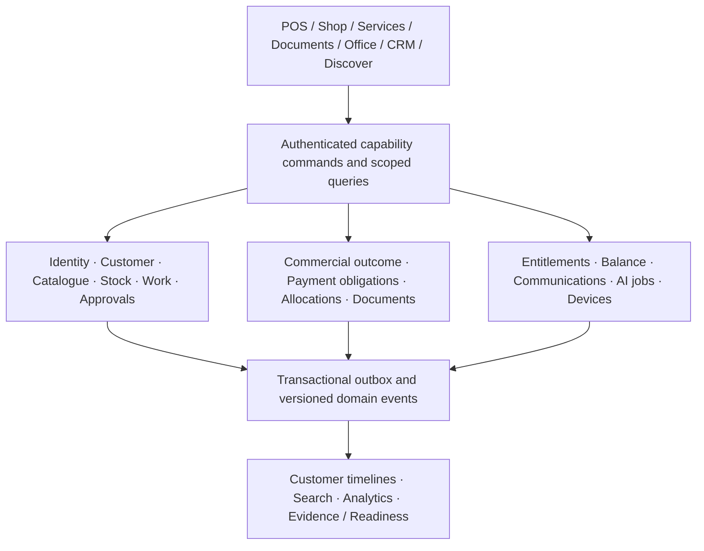

# Ascend connected platform: build continuation plan

**Review date:** 5 November 2026  
**Repository baseline:** `48b17e8` — `Drop business_customers before changing its shape`  
**Status:** Proposed execution baseline; product decisions identified separately  
**Scope:** All 12 supplied PRDs/specifications, existing repository, and the dependencies required to deliver them safely.

## 1. Recommendation

Continue the current modular monolith and shared database. Preserve the working product surfaces and useful domain foundations. Make the next release a **connected-core hardening release**, followed by a controlled free POS and connected commerce pilot. Build paid workflows on top of proven transactions, permissions, consent, entitlements and recovery.

The updated product is larger than seven application tabs. POS, Shop, Services, Documents, Office, CRM and Discover are entry points into the same business records and workflows. A Shop order, payment, receipt, customer timeline entry, Office task and readiness observation must remain connected to one commercial outcome. Buying an upgrade must never buy a better Sustainability Score or evidence rating.

The repository already contains substantial implementation: 66 migrations, shared identities and customers, catalogue and inventory, POS offline storage, orders and bookings, payments and documents, Office workflows, Discover, commercial tables, event/evidence infrastructure and readiness. Rebuilding these as separate applications would discard progress and multiply reconciliation problems. However, implementation breadth is not equivalent to release readiness. The source review found concrete regressions and important mismatches with the new commercial model.

The execution order is:

1. Reconcile the specifications and establish repeatable database and journey tests.
2. Repair correctness, tenant authorization, transaction boundaries and retry behavior.
3. Complete the free operating core and shared Customer/CRM, Catalogue, Work and Communications contracts.
4. Pilot connected POS, Shop and basic Services journeys with dependable Documents and Office essentials.
5. Release metered Smart Setup, paid passes and fixed-price Discover only after billing and entitlement gates pass.
6. Expand advanced Services, full Office, advanced Documents and CRM automation through separate acceptance gates.

This sequence deliberately stages some requirements labelled MVP/Must in older product documents. Those deferrals require an explicit release-scope decision; they do not become “completed” or disappear from the requirement register.

## 2. Review method and source authority

The [source register](SOURCE_REGISTER.md) inventories **3,550 numbered requirements in 185 families**, preserving their original text and source locations in [requirements.json](requirements.json). All twelve documents were read, including the Services DOCX body. Original Markdown and the original Services DOCX are archived in `sources/`; the Services text extraction supports searching and traceability. Narrative scope, metrics and rollout guidance were also considered.

The repository assessment is source-level. `npm run check` passed TypeScript and the contrast check: 101 files, 51 tokens, zero contrast failures, one ignored item. No checked-in automated unit, integration or end-to-end suite was found, and the existing CI checks do not establish SQL or commercial correctness. No deployed database, live provider, real merchant, device or printer was exercised. There is no defensible implementation-completion percentage yet.

Use this authority order:

| Source | Role in the plan |
|---|---|
| Master v3 | Platform promise and explicit supersession of conflicting earlier commercial, onboarding, catalogue and POS deployment rules. Free useful POS; optional paid value; retained historical access. |
| Capability & Business Graph v1 | Newer cross-product ownership and integration architecture. Shared capabilities and records; immediate CRM, Customer, Communications and Catalogue foundations. |
| Commercial v1 | Offer types, balance, sponsorship, processing capacity, paid passes, distinct revenue streams and no double charging. Prices remain hypotheses until approved. |
| POS v3 + Deployment/Hardware v1 | Free Android BYOD, adaptive layouts, offline operations and four deployment classes with field qualification. |
| Catalogue/Smart Setup v1 | Shared product/service catalogue, free manual setup, paid processing, review and assisted setup. |
| CRM v1 | Merchant-scoped relationships, pipeline, follow-ups, consent, campaigns and attribution; adds an explicit product surface missing from the older product-set list. |
| Office v2 | People, Work, approvals, expenses and procurement; essential embedded workflows plus paid full Office. |
| Shop v2 | Storefront, checkout, fulfilment, public trust, discovery and customer experience. Apply newer commercial overrides explicitly. |
| Services v1 | Six service operating models and their operational/payment lifecycles. Replace older silo/subscription assumptions with shared capabilities. |
| Documents v2 | Shared document lifecycle, immutable issued records, allocations, customer actions and advanced document workflows. Resolve quote entitlement conflict. |
| Discover v2 | Fixed-price promotion lifecycle, eligibility, moderation, measurement, sponsor separation and customer discovery. |

Newer architecture is not blanket permission to discard older detailed behavior. Resolve only actual conflicts; retain compatible requirements. [DECISIONS.md](DECISIONS.md) records the key overrides and open choices. Attached documents are specifications to evaluate, not operational instructions to execute.

## 3. What to retain, repair and complete

| Area | Existing foundation | Required continuation |
|---|---|---|
| Identity and access | Person/business/member model, custom OTP/session, device and staff access, browser database exposure hardening | Central action-level capability and location/team scope, delegation, offboarding, public-link rules and adversarial tenant tests. |
| POS | Sale/stock routines, durable offline client storage, held carts, shifts, receipts, refunds, printer abstraction | Reconnection and conflict verification, compact portrait flow, accurate payment confidence, supported Android packaging and real printer qualification. |
| Catalogue | Shared catalogue, images, channel listings, stock records, one-request AI suggestion | Atomic editing/publication, product/service contracts, batch imports, durable reviewed Smart Setup jobs, processing ledger and merge controls. |
| Shop | Public storefront, checkout, order management, customers, stock reservations | Concurrent availability enforcement, trustworthy totals/policies, fulfilment and cancellation invariants, SEO/private previews, source attribution. |
| Services | Booking, availability/time-off, deposits/refunds and shared customers | Restore deposit holds; final confirmation capacity checks; requests without mandatory times; explicit model-by-model delivery. |
| Documents | Issuance, payment/POS receipts, credits, supplier POs, receivables, reminders, branding/templates | Snapshot and allocation regression tests, public-link security, delivery failure handling, offline draft boundaries and advanced pack policy. |
| Office | Work board, teams, scheduling, leave, locations, projects/milestones and command centre | Consistent scopes, essential versus full capabilities, source-linked task ownership, approval/expense/procurement lifecycle verification. |
| CRM | Shared customer identity plus consent work in migrations 0064–0066 | Explicit CRM product/capabilities, timeline projections, leads/opportunities, shared follow-ups, safe merges and channel-purpose consent. |
| Discover | Campaign and moderation tables, eligibility, tracking and admin surfaces | Replace click-budget charging with fixed-price campaign contracts; implement expiry, refunds, sponsorship and truthful attribution. |
| Commercial | Price book, purchase records, entitlements and sponsored grants | Real purchase settlement flow, accurate timed capability evaluation, usage accounting, balance reconciliation and migration of legacy offers. |
| Evidence/readiness | Event outbox, relay, evidence, scoring and sharing infrastructure | Versioned events and lineage, confidence taxonomy mapping, reversal handling and once-only outcome attribution. |

### Findings that should drive the first release

These are concrete source findings, not claims about which migrations are deployed in production. Paths below are repository-relative.

| Finding | Evidence | Consequence and required verification |
|---|---|---|
| Deposit-hold regression | `supabase/migrations/0020_booking_deposits.sql` adds hold expiry; `0064_one_customer_record.sql:400` replaces `book_service` without that initialization | Reconcile the latest function with the deposit policy. Test unpaid expiry, paid confirmation, late provider success and duplicate requests. Do not just restore old code and lose customer unification. |
| Entitlement validity is status-based | `0044_capability_register.sql` resolves active/grace without time bounds; `lib/domains/entitlements.ts:69` omits starts/expiry and does not enforce grace deadline | Enforce server-time validity centrally, even if expiry jobs are late. Verify future starts, grace exhaustion, overlapping grants, revocation and history access. |
| Product activation can grant indefinitely | `0043_enable_product_set.sql` creates/re-enables a free_start grant with no expiry | Separate enabling a product surface from purchasing premium capabilities. Ensure no activation endpoint grants full paid Office/Documents inadvertently. |
| Shop stock is reserved without a final availability guard in the latest function | `0064_one_customer_record.sql:288–397`, `place_shop_order` | Define stock policy and lock/check it in the authoritative mutation. Race a Shop order against a POS sale for the last unit; verify reservations release exactly once. |
| Catalogue publication is split across writes | `app/api/shop/catalogue/route.ts` inserts item, then listing, then publishes event | Use one owned atomic mutation, idempotency and transactional outbox. Simulate failure at every boundary; enforce edit/publish permissions beyond active membership. |
| Customer merge can broaden marketing consent | `0064_one_customer_record.sql:135` ORs consent flags; `0066` introduces a richer consent record | Merge identity without synthesizing permission. Preserve withdrawal and provenance; reconcile legacy flags with channel-purpose consent before any campaigns. |
| Customer creation and public retries need stronger contracts | `0064` uses lookup-then-insert; Shop lookup is by client_ref; booking stores optional client_ref in JSON | Verify unique-key concurrency, scoped deduplication, payload mismatch rejection and identical replay responses. Prevent another tenant's key from returning its record. |
| Billing is a catalogue of offers, not a finished purchase journey | `app/billing/page.tsx:15`; `0065_price_book.sql:116` | Add authoritative settlement, idempotent fulfilment, receipts/refunds and reconciliation. Do not equate insertion of a purchase row with verified payment. |
| Existing pricing encodes older assumptions | `0065_price_book.sql` includes permanent catalogue capacity and Assurance described as verification | Replace future offers with approved processing/pass/service semantics; protect existing purchases. Separate managed support from independent verification. |
| Discover currently charges clicks | `0026_discover.sql:184`, `record_discover_click` | Fixed-price promotion needs a revised charging/lifecycle contract, not only renamed buttons. Keep clicks as analytics. |
| Native printer support remains an integration boundary | `lib/pos/printer/index.ts:33,96` expects `window.AscendPrinter`; no native Android project was found | Prototype packaging and transport on actual candidate hardware. Browser printing is not evidence of portable/integrated printer certification. |
| Application events can be emitted after the business write | `lib/domains/events.ts` and catalogue route | Bring durable events into the same transaction as each state change. Add versioned payloads and retry-safe consumers. |

## 4. Target architecture and domain ownership

Keep Next.js and Supabase/Postgres as the current delivery platform. Organize the modular monolith around owned capabilities, not parallel per-product databases. “Business graph” describes connected business entities and typed relationships; it does not itself require adopting a graph database or microservices.

### Shared contracts to establish before adding new surfaces

| Capability | Owns | Other products must do |
|---|---|---|
| Identity & access | Person, business, membership, role/capability scope, location, delegation, device actor | Request authorized actions; never infer that an active member can edit everything. |
| Customer | Merchant relationship, contact normalization, aliases, source, safe merge, timeline references | Reuse one merchant-scoped customer; never expose another merchant's relationship through a shared phone. |
| Catalogue & media | Product/service identities, variants, canonical attributes, source media, review states, listings | Use shared item IDs with channel-specific presentation/availability; preserve manual editing. |
| Inventory | Movements, availability policy, reservations, receiving, returns, adjustments | Request atomic reserve/release/consume; never independently decrement a product quantity column. |
| Commercial transaction & finance | Canonical outcome reference, obligations, payment intent/confirmation, allocation, refund/settlement | Distinguish an order, invoice, receipt and cash movement. Link them without counting revenue multiple times. |
| Documents | Drafts, issued snapshots, numbering, conversions, credits, delivery/access history | Create through the document engine. Services quotes and procurement POs must not become unrelated document stores. |
| Work & approvals | Tasks, assignments, checklists, milestones, approval decisions and audit | Embed the same work record in Services/Shop/CRM/Office; avoid a second task when retried. |
| Communications & consent | Templates, channel-purpose consent, preferences, dispatch, delivery, suppression, cost | Submit a send request; check permission at send time; distinguish transactional and marketing purpose. |
| Commercial access | Offer versions, purchases, entitlements, processing units, money balance, sponsored credits | Ask the shared evaluator. Never implement product-specific billing truth or imply spend improves evidence. |
| Events, evidence & readiness | Event envelope, durable delivery, provenance, confidence, scoring rules and read models | Publish a factual event through an atomic command; derive evidence with lineage and explicit eligibility. |

Each domain needs one mutation owner and documented inputs, authorization, invariants, idempotency key scope, output, error codes, emitted event and reconciliation rule. Existing SQL RPCs can remain the atomic owners. Server routes should authenticate, validate and call them; they should not independently assemble half a transaction.

Use stable IDs and business ownership throughout. Introduce a canonical commercial-outcome reference incrementally for existing sales/orders/bookings instead of rewriting history. An invoice can create an obligation; a payment can allocate against one or more obligations; a credit changes the obligation; a refund moves money. Recording all four must not record four sales. Maintain separate state machines for order, payment, fulfilment, document, booking, work and campaign.

Events need an ID, schema version, business and source entity, actor/device, occurrence and receipt times, correlation/causation and an idempotency context. Define compatibility mappings for current event names. An outbox consumer may retry; effects must deduplicate. Evidence records reference source events and later reversals, rather than silently rewriting the original fact. Map merchant-declared, customer-confirmed, provider-confirmed, system-recorded and institution-verified meanings explicitly; they are not interchangeable rankings of payment success.

Search and timeline projections must enforce permissions at query time, including staff privacy and revoked grants. Build a narrow permission-scoped unified search after entity ownership is stable. AI calls should pass through a gateway with business authorization, source retention, budget reservation, model/output provenance, field confidence, merchant review and failure reconciliation. An external provider callback must pass signature, replay and settlement checks through the integration gateway.

## 5. Product release scope

### Free foundation and first connected pilot

**POS:** Android BYOD/manual setup, shared catalogue and images, barcode/manual lookup, sale totals, cash/manual and supported integrated payment initiation, truthful confirmation state, receipts, basic stock, cashier/shift continuity and durable offline sync. Compact portrait keeps the total/action visible; wide counters share the same engine. Offline UI distinguishes saved locally, pending sync, synced and rejected. A printer failure never rolls back a completed sale. Never promise a provider-confirmed payment while offline without confirmation.

**Shop:** Private preview and fast draft, publish only with required merchant/customer-facing details, shared listings, guest checkout, server-authoritative price/fees/stock, supported delivery/pickup options, separate payment/fulfilment states, secure tracking, cancellation/release and source attribution. Add social previews, canonical URLs, sitemap/redirect behavior and access-controlled drafts. Customer disclosures and policy snapshots must match the actual fulfilment offered. Defer partial fulfilment only through an approved release decision with a clear cancel/contact flow.

**Services:** Start with fixed appointments and request-to-book. Requests without a time must work. Final confirmation validates provider eligibility, working hours, time-off, buffers, capacity, location/resource conflicts and deposit policy atomically. Restore holds and late-payment handling. Then add quote-first and field jobs, then classes/resources, then project/milestone depth. Shared Document, Work, Customer and Payment references apply from the first mode. No-show is a delivery status, not proof of payment or completed revenue.

**Documents essentials:** Connected receipts and basic invoicing, correct issuer/customer snapshots, numbering, immutable issued content, allocations, safe conversions/credits, secure sharing and history/export. Offline work is a draft with provisional identity until authoritative issuance. Reminder jobs re-check balance, cancellation and dispute before sending. Uploading a Briefcase file does not make its contents verified evidence. Advanced templates, recurring documents, signatures, external accountant workflows and verified reports follow separately.

**Office essentials:** Shared staff identity, cashier/shift continuity, basic service availability, assigned fulfilment/service tasks and the approvals essential to those workflows. Staff see their own allowed work and location scope. Buying full Office adds cross-business operations depth; it must not disable an anchor product's essential workflow on expiry.

**CRM essentials:** Shared merchant customer profile/history, tags, notes, lead/opportunity ownership, a simple configurable pipeline and Work-backed follow-ups. No cross-merchant customer database. Opportunity won is a pipeline state, not an additional sales transaction. Timeline and outstanding balances respect permissions. Imports and follows do not imply marketing consent. Basic CRM comes before campaign automation.

### Paid value after the correctness gates

**Smart Setup/Assisted Setup:** Durable Draft → Processing → Review → Completed/Failed jobs for images and structured imports. Show units and estimated cost before submission. Reserve units, reconcile actual processing and apply fair retry/reversal rules. Products remain merchant-owned when units run out. Review uncertain fields, duplicates, variants, price and stock before publication; never invent sensitive product claims. Assisted agents use time-limited delegated access with merchant approval and quality attribution.

**Discover:** Approve product/shop/location promotion packages and extensible service eligibility; keep later auction/bidding behavior out of the fixed-price pilot. Eligibility, moderation, scheduling, active period, expiry, rejection, pause/cancellation and refund rules must be explicit. Paid and sponsored campaigns share operational controls but separate ledgers/reporting. Views/clicks are interactions; only supported linked completed outcomes are conversions. No budget spend or raw engagement directly changes readiness.

**Full Office:** Cross-team planning, dependencies, recurring work, project budgets/milestones, leave/attendance workflows, delegation and multi-level approvals, expenses and procurement. Model purchase request → approval → PO → partial/damaged receipt → stock → supplier invoice → payment with separately auditable states. Claim approval is not payment. Retain private staff records and auditable offboarding; avoid continuous-location surveillance. Business Pulse is an operational summary, not a renamed Sustainability Score.

**Advanced CRM:** Segments and explainable RFM/freshness, campaign draft/audience/cost preview, channel-purpose send checks, suppression/frequency limits, delivery and attributable conversions, paid automation and later shared inbox. Start with one fully supported channel rather than shallow integrations everywhere.

**Advanced Services/Documents:** Quote revisions and customer acceptance, class capacity and attendance, private field evidence, project payments/milestones, recurring document schedules, signatures, template packs, formal review and partner access. Each mode gets an end-to-end acceptance suite and a product entitlement decision before launch.

### Hardware and Assurance

Run an early packaging/printer spike while foundation repairs proceed. Decide between a native Android shell/bridge and another viable supported runtime using measured device tests; do not assume the current web bridge is a shipping implementation. Keep the commercial/domain engine shared.

Qualify four classes: A smartphone BYOD, B phone plus Print Kit, C integrated Smart POS, D counter deployment. The Hardware spec calls for a 20–30 merchant pilot with at least two Smart POS models and two portable printer models across weak and stronger networks. Record supported OS/firmware, transport, pairing/reconnect, paper width/encoding, battery/charging, power-loss recovery, reprint labeling and support procedure. Include portrait and counter UX and scanner/cash-drawer behavior where offered.

Track serial/asset, allocation, installation, merchant training, test sale/test receipt, warranty, repair/replacement and technician attribution. BYOD is not subject to involuntary fleet management. Managed-device actions need authorization and audit. Assurance is an operational support/service promise with a defined service scope, not the purchase of verification confidence. No hardware model is certified by this review.

## 6. Execution roadmap and release gates

Use gates to authorize progression. The effort bands below are planning allowances, not a delivery commitment: **S** up to roughly one engineer-week, **M** one to three, **L** three to six, **XL** needs decomposition. They are not additive calendar estimates and exclude unknown production repairs, vendor lead times and full PRD parity. Re-estimate after the first gate using actual team capacity.

| Phase | Deliverable | Dependencies | Effort signal | Exit gate |
|---|---|---|---|---|
| R0 — Baseline | Approved conflict/scope ledger, deployed-schema inventory, reproducible migrations, automated test harness, journey map | Read-only staging/production inventory when available | M | Latest effective RPCs documented; migration replay works; failing regressions reproduced; release owner assigned. |
| R1 — Correctness | Booking holds, stock race handling, tenant authorization, time-valid entitlements, atomic catalogue/events, safe customer merge | R0 | L–XL | Critical invariants pass database and API tests; no unresolved critical cross-tenant/money/data-loss defects. |
| R2 — Connected foundation | Shared domain contracts, canonical outcome links, Customer/CRM basic, Work/Comms integration, free/paid access matrix | R1 for shipping; contract design starts in R0 | XL | One connected journey has consistent identity, stock, money, documents, timeline, work and evidence without duplicate outcomes. |
| R3 — Controlled pilot | Reliable free POS, Shop and fixed/request Services, Documents/Office essentials, qualified initial hardware | R1/R2 and hardware spike | XL plus field lead time | Merchant pilot passes recovery, workflow and support gates; known limitations documented; no unsupported hardware promises. |
| R4 — Paid growth | Smart Setup, settlement-backed purchases, passes/usage, fixed-price Discover, sponsor reporting | R1/R2, approved offers, payment reconciliation | XL | Every charged unit/purchase has reproducible ledger and grant reconciliation; expiries preserve history; campaign claims are accurate. |
| R5 — Product depth | Quote/field/class/project Services; full Office; advanced Documents; CRM segmentation/automation | Relevant shared capabilities and approved scope | Multiple independent releases | Each mode/pack passes its own source-ID acceptance matrix and expiry/recovery tests. |
| R6 — Expansion | Multi-location depth, institutional access, partner operations, advanced readiness and optimization | Stable pilot economics and governance | Re-estimate | Scale/load/support and evidence governance reviewed; expansion market rules separately scoped. |

Hardware feasibility, test design and source traceability can progress alongside R0–R2. Paid work can be designed early, but live charging must wait for the commercial gate. Do not expand Services modes while the common confirmation/payment state machine remains unproven.

### First two iterations

Treat these as ordered work packages, not a promised two-week delivery date.

**Iteration 1:** Record deployed migration versions without changing them; spin up a disposable database; replay 0001–0066; write regression tests for booking deposit expiry, concurrent last-unit purchase, repeated client references, entitlement expiry and tenant/customer access. Resolve D01–D07 from the decision log. Inventory all service-role routes and mutation owners. Patch the reproduced critical issues through forward migrations and API changes, retaining their existing customer and event behavior. Deliver a tested vertical slice: create product → sell → collect/record payment correctly → receipt → stock/customer/evidence views.

**Iteration 2:** Complete atomic catalogue publication and authoritative authorization; introduce consistent idempotency/event envelopes; harden Customer/consent merging; establish the free/paid capability matrix and basic CRM follow-up slice. Test a Shop order and a deposited service booking through the same Customer/Documents/Work foundations. Run the Android/printer spike and choose the first supported pilot configuration. Draft approved commercial offer definitions before implementing billing checkout.

Do not carry a failing correctness gate into the next iteration simply to maintain a calendar. The [execution backlog](EXECUTION_BACKLOG.md) breaks the work into assignable deliverables with acceptance evidence.

## 7. Migration and data protection strategy

1. Inventory what is actually deployed and what records already exist. Repository history alone cannot prove this. Capture schema, migration ledger, function definitions and row counts without exporting unnecessary personal data.
2. Make new forward migrations; do not edit already-applied migrations to pretend a regression never existed. Test both a clean replay and upgrade from a representative existing database.
3. Add compatible fields/relations first, backfill in bounded batches, verify, switch readers/writers and retire old paths only after reconciliation. Prefer one authoritative writer throughout; any temporary dual-write path needs explicit reconciliation and a removal gate.
4. Preserve business/customer/item IDs and issued document snapshots. Use aliases and auditable merge lineage. Ambiguous customer matches require review; never globally merge customers merely by a phone match.
5. Map existing transactions to canonical outcome IDs and prove aggregate equality. Do not regenerate receipts, issue new invoice numbers or improve historical verification automatically.
6. Grandfather or explicitly migrate paid capacity/pass purchases with a recorded equivalent, credit or refund policy. Never silently invalidate purchased value while correcting the catalogue model.
7. Preserve historical read/export access on expiry while separately controlling premium new actions, public publication and active services according to an approved matrix.
8. For consent backfills, record reconstructed/unknown provenance honestly. Do not assign an affirmative marketing permission from an inferred timestamp. Stop sends while relevant consent is unresolved.
9. Reconcile record counts, money totals, allocation totals, stock movements/reservations, outstanding obligations, active grants and event/evidence counts. Keep an exception report rather than discarding unmatched records.
10. Rehearse backup restore and recovery in a disposable environment. Prefer feature rollback/forward fixes where financial data makes destructive schema rollback unsafe. Agree recovery objectives before the pilot and test them.

## 8. Verification and operational readiness

| Test layer | Required evidence |
|---|---|
| Database invariants | Money precision, valid transitions, atomic commands, tenant ownership, reservation conflicts, allocation limits, durable outbox and unique idempotency under concurrency. |
| API/security | Owner/manager/cashier/accountant/staff/assisted-agent matrix; location/team scope; revoked member/device; cross-business IDs; public-link expiry; malicious imports/media; webhook authenticity/replay. |
| Domain regression | Latest migration behavior, not isolated old routines. Booking hold expiry; final availability; returns vs credits vs refunds; purchase settlement; entitlement start/expiry/grace. |
| Browser/mobile journeys | Guest checkout, request with no slot, offline POS, reconnect, duplicate taps, printer errors, customer self-service, sensitive staff views and no false success messages. |
| Commercial | No charge without matching fulfilment/reversal policy; no duplicate grant; money versus sponsor-credit separation; processing reservations/retries; fixed-price campaign timing; history on expiry. |
| Evidence | One completed outcome counted once; reversals propagate; confidence/provenance retained; campaign spend, uploads and purchase grants cannot raise score directly. |
| Field acceptance | Low-cost Android, intermittent network, battery/app restart, printer disconnect/paper-out, staff handover and merchant-assisted recovery. |

Five mandatory end-to-end examples:

1. **Retail:** Offline POS sale → reconnect retry → one sale and stock effect → receipt reprint → refund/return → correct customer and evidence history.
2. **Commerce:** Last item checked out concurrently online and at POS → approved availability policy enforced → failed/expired checkout releases once → payment/fulfilment remain distinct.
3. **Service:** Deposit-required appointment → unpaid hold expires → late payment is reconciled safely → reschedule/cancel/refund → one customer timeline and work record.
4. **Operations:** Quote/booking/order creates Work → scoped staff acts → approval recorded → document/payment changes reflected without duplicate customer, task or revenue.
5. **Commercial:** Purchase or sponsored grant → entitlement starts/expires accurately → historical records remain readable → retry/refund does not duplicate value → score unchanged by purchase.

Add dashboards and alerts for stuck outbox jobs, retry/dead-letter counts, sync lag, rejected offline writes, payment reconciliation mismatches, expired holds/reservations, failed dispatch, erroneous grants and setup-job cost discrepancies. Logs need correlation IDs without exposing contact details, tokens or private documents. Define support runbooks for each failure mode before onboarding merchants.

Pilot release requires a named product owner, engineering owner, QA/field acceptance owner and operations/support owner. People may share roles; accountability cannot be omitted. Record approved recovery objectives, incident response, backup restoration result, supported device list and rollback/kill-switch decisions. Block widening rollout on any unresolved critical authorization, money, unrecoverable data-loss or materially misleading payment-state defect. Establish numeric performance/sync targets from measured pilot baselines rather than inventing SLA claims now.

## 9. Measurement, commercial discipline and scope control

Create a metric dictionary with event source, denominator, cohort window, exclusions and owner. Track first manual catalogue item, first completed sale, first synced sale, first published Shop/service, customer-originated conversion, repeat active merchant, failed/successful sync, reconciled payments and support burden. Separate staff-generated tests and duplicates from real merchant activity.

The Shop first-year goals of 1,000 activated shops, 50% revenue-active and 40% promotion adoption are planning hypotheses. Specify the cohort/window and distinguish paid promotion adoption from sponsored reach. Services activation should follow its customer-originated engagement within 30 days definition. Never report “order created” as collected revenue or “message delivered” as an attributable sale.

Track margin separately for setup processing, assisted labor, hardware, Assurance, payments, Discover and software passes. Include AI/provider costs, failed-job reversals, support time, payment fees, replacement/warranty cost and sponsor restrictions. Commercial examples such as Office bands and Discover packages require approval; they are not validated willingness-to-pay or final published prices.

Do not expand into full payroll, full ERP/accounting, a universal multi-merchant cart, bespoke per-product customer databases or a new graph database under this plan. Finance, Inventory/Procurement and Readiness need shared foundations now, but no dedicated updated detailed PRDs for those entire products were supplied. Record their remaining scope as discovery rather than silently inventing a full product.

## 10. Definition of done and next build instruction

A feature is done only when its requirement IDs and applicable decision overrides are linked; the owning capability and state changes are documented; permissions, money/stock consequences, retries and offline behavior are verified where applicable; migrations and existing-data upgrade pass; errors are recoverable; metrics/support instructions exist; and a product owner accepts the visible journey. Type-checking or the presence of a screen is insufficient evidence.

The next implementation task should be **B01–B08: establish the executable baseline and close the reproduced shared-core defects**, beginning with booking holds, stock concurrency and entitlement validity. Do not start by building more product navigation or by rewriting the repository. This review delivers the plan and traceability artifacts only; application and database behavior have not been changed.
